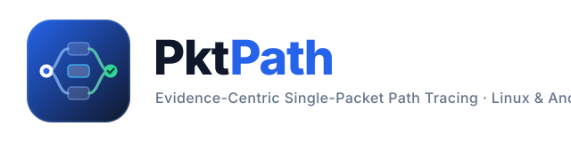

<p align="center">
  <picture>
    <source media="(prefers-color-scheme: dark)" srcset="assets/wordmark-dark.svg">
    <source media="(prefers-color-scheme: light)" srcset="assets/wordmark-light.svg">
    
  </picture>
</p>

<p align="center">
  <a href="https://github.com/M1nt-Ch0c0/pktpath/actions/workflows/ci.yml"></a>
  <a href="LICENSE"></a>
  
  
</p>

`pktpath` is an evidence-centric, zero-intrusion single-packet path tracing framework for **Linux (`x86_64` / `arm64`)** and **Android (`arm64`)** kernels (`>= 5.10`, tested on `6.1`–`6.12`), paired with **PktPath Studio v2.0** — a GUI-first, modular plugin workbench.

It traces individual packets through the Linux egress/TC/qdisc/driver pipeline (such as `HTB -> fq_codel / pfifo / sfq / netem -> ndo_start_xmit`), reconstructs exact multi-branch SKB object DAGs (`clone`, `copy`, `requeue`, `txq STOP/WAKE`), measures per-queue sojourn latency, surfaces automated bottleneck & anomaly insights, and supports unlimited extensibility without recompiling eBPF or Studio.

---

## PktPath Studio v2.0 — "Everything is a Plugin" Microkernel

Inspired by DSH / Cordis microkernel + Schemastery design principles, **every core capability in PktPath Studio v2.0 is a hot-reloadable plugin** with effect-scoped lifecycle management and an auto-generated **Visual Schema-Form configuration UI** (zero raw JSON or CLI required for end users):

### 11 First-Class Built-in Plugins

| Category | Plugin ID | Capability |
|---|---|---|
| **Transports** | `builtin.transport.android-adb` | Android USB/Wireless ADB device discovery, root check, ARM64 collector sync (disable to remove Android tab completely) |
| **Transports** | `builtin.transport.linux-ssh` | Generic Linux remote host capture over OpenSSH (`x86_64` / `arm64`), auto-matched static collector |
| **Transports** | `builtin.transport.offline` | Offline local session folder & history store (zero device dependency) |
| **Collectors** | `builtin.collector.ebpf-tc` | Pure upstream Linux eBPF TC/Qdisc collector defaults & runtime tuning |
| **Collectors** | `builtin.collector.kernel-ext` | **Visual Dynamic Kernel Extension Builder** — add arbitrary `struct sock` BTF fields (up to 16) and arbitrary TC qdisc probes (up to 32 concurrent via dynamic BPF template cloning) using visual cards, **zero JSON** |
| **Analyzers** | `builtin.analyzer.dag-reconstruct` | Evidence-centric multi-branch SKB DAG & clone lineage reconstructor |
| **Analyzers** | `builtin.analyzer.anomaly-radar` | Automated bottleneck, drop, requeue & sojourn radar with clickable sample jump cards & configurable ms thresholds |
| **Exporters** | `builtin.exporter.pcapng` | Wireshark `.pcapng` exporter with embedded per-packet sojourn metadata |
| **Exporters** | `builtin.exporter.redact` | Deterministic keyed SHA-256 session privacy redactor |
| **Exporters** | `builtin.exporter.csv-report` | One-click Excel-friendly UTF-8 CSV or Markdown diagnostic report exporter |
| **UI & Theme** | `builtin.ui.theme` | Live hot-switchable light/dark theme, 5 accent palettes, density & font scale |

### Open-Ended External Plugin Bundles (`.pktplugin` / `.zip` / Folder / `.json`)

From the full-page **🧩 Plugin Center**, users can preview capabilities and install external bundles that extend **any combination** of:
- **Dynamic Kernel Extensions** (`kernel.ext`): BTF-resolved `struct sock` fields + dynamically cloned TC qdisc kprobes/kretprobes
- **Post-Analyzers** (`analyzer`): Out-of-process JSON-over-stdio hooks that emit live diagnostic insight cards and extra KPI tiles
- **Exporters** (`exporter`): Custom export buttons registered directly into the Workbench toolbar
- **UI Slot Widgets** (`ui.slot`): Custom JS/CSS widgets mounted into `canvas.banner`, `workbench.toolbar`, `sample.extra`, or `sidebar.extra`
- **Visual Config Schema** (`config_schema`): Auto-rendered graphical configuration forms persisted in `plugins_config.json`

See [plugins/README.md](plugins/README.md) and the runnable bundles in [plugins/examples/](plugins/examples/).

---

## Windows Desktop Distribution (Zero Console Window, No Bundled ADB)

`bin/pktpath-studio.exe` is a single-file Windows GUI executable (`CGO_ENABLED=0`, `PE Subsystem = 2`, **zero black console window flash**):
- Embeds `pktpath-android-arm64`, static `pktpath-linux-x86_64`, and the full offline Web UI
- Does **not** bundle `adb.exe` or USB DLLs; discovers system `adb` from `--adb`, `PKTPATH_ADB`, `PATH`, or Android SDK paths, and invokes every child process (`adb`, `ssh`, `scp`, external hooks) with `CREATE_NO_WINDOW` (`0x08000000`) + `HideWindow = true`

### Quick Start

```powershell
# Launch PktPath Studio v2.0 (opens default browser, zero console window)
.\bin\pktpath-studio.exe

# Optional flags
.\bin\pktpath-studio.exe --window                          # Native Win32 WebView2 window
.\bin\pktpath-studio.exe --adb C:\platform-tools\adb.exe   # Explicit system adb path
.\bin\pktpath-studio.exe --plugin-dir D:\my-plugins        # Custom external plugins directory
.\bin\pktpath-studio.exe --headless --port 18080           # Headless localhost HTTP API
.\bin\pktpath-studio.exe --selftest --dev wlan0            # Automated runtime + device E2E check
```

---

## Repository Layout

```
pktpath/
├── include/
│   ├── pktpath_wire.h         # Wire format v1.0 (.pktb blocks, TLV tags 0x0320..0x032F)
│   └── pktpath_bpf.h          # Shared BPF/userspace ABI + reusable probe templates & 16 sock slots
├── bpf/
│   └── probe_core.bpf.c       # Dual-arch eBPF probes (arm64 + x86_64) + 4 dynamic qdisc templates
├── device/
│   ├── main.c                 # Device CLI: inspect, record (--plugin / --plugin-dir)
│   ├── recorder.c             # BPF loader, runtime sentinel site_id cloner & ringbuf controller
│   ├── plugin_loader.c        # Zero-dependency C11 JSON plugin loader + BTF field resolver
│   ├── btf_parse.c            # Pure-C /sys/kernel/btf/vmlinux parser
│   └── topo_netlink.c         # Netlink RTM_GETQDISC / RTM_GETTCLASS topology dumper
├── analyzer/                  # Python offline analyzer (reconstruct, stats, show, export_pcapng, redact)
├── studio/
│   ├── pkg/kernel/            # Cordis-style Go microkernel, Schemastery schema engine & external bundle loader
│   ├── pkg/plugins/           # All 11 first-class built-in plugins
│   ├── pkg/server/            # HTTP API (/api/kernel/*, devices, capture, sessions, exports)
│   ├── pkg/adb/, pkg/sshclient/, pkg/wire/, pkg/reconstruct/, pkg/export/
│   └── web/                   # Offline GUI Workbench + Full-Page Plugin Center (plugin-center.js)
├── plugins/                   # Plugin SDK docs & runnable v2.0 external bundle examples
├── scripts/                   # Reproducible build scripts (build_bpf.py, build_device.py)
├── pktpath.py                 # Host Python CLI entrypoint
├── LICENSE                    # Apache-2.0 (userspace/host) + Dual BSD/GPL (bpf/)
└── README.md
```

---

## Build Instructions

### Prerequisites

- **eBPF**: `clang` (`>= 15`, BPF target `bpfel`) and `pyelftools` (`pip install -r requirements-build.txt`)
- **Android arm64 collector**: Android NDK (`aarch64-linux-android28-clang`; CI compile-checks with official NDK r28b / 28.1.13356709, not on-device)
- **Linux x86_64 static collector**: `gcc -static` (Linux or WSL)
- **Linux arm64 static collector**: `aarch64-linux-gnu-gcc -static` (optional local; required in CI)
- **PktPath Studio (Windows)**: Go `>= 1.22` (`CGO_ENABLED=0`)
- **Host CLI**: Python `>= 3.10` (standard library only)

```powershell
# 1. Compile dual-arch eBPF bytecode headers (arm64 + x86_64)
python scripts/build_bpf.py --arch all

# 2. Build Android arm64 + static Linux x86_64 device collectors
python scripts/build_device.py --target all

# 3. Build single-file PktPath Studio v2.0 Windows GUI binary
python studio/scripts/build_studio.py
```

---

## License

- Host tools, device userspace controller, and PktPath Studio: **Apache License 2.0** (see [LICENSE](LICENSE)).
- eBPF kernel probes (`bpf/`): **Dual BSD/GPL**.
